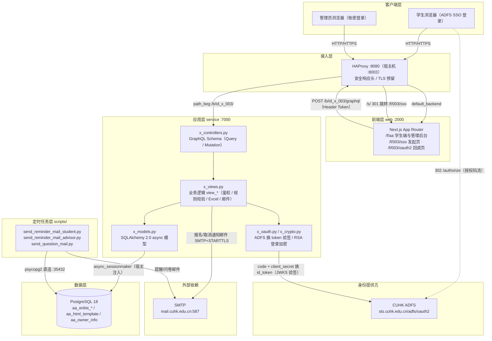
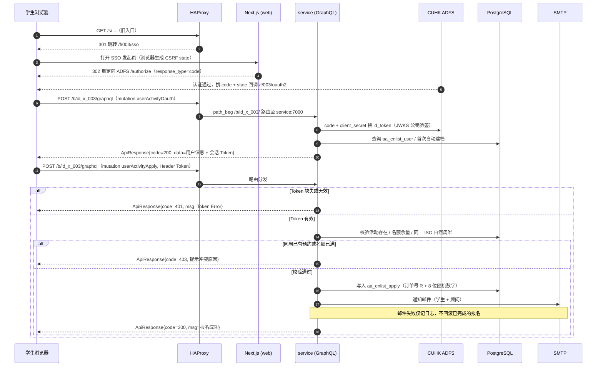

<div align="center">

# id_x_003: CDC 校友咨询（Alumni Advising）预约系统

**把「找校友聊一次职业规划」从邮件往返，升级为 SSO 自助预约、邮件自动触达、数据一键导出的全流程线上平台**


</div>

---

## 1. 简介 (Introduction)

- **Slogan**: 为经管学院职业发展中心（Career Development Center, CDC）「校友咨询项目（Alumni Advising Program）」提供一对一咨询的全流程线上预约平台。
- **Description**: 本项目是 i-Core 平台的业务插件模块（`x_models/id_x_003`），覆盖**咨询主题发布 → 时段排期 → 学生报名 → 邮件通知 → 取消与问卷回访 → 数据查询导出**的完整业务闭环。学生通过大学统一身份认证（Active Directory Federation Services, ADFS）以 OAuth2 授权码流单点登录后自助报名与取消；管理员（CDC 运营人员）以账号密码登录管理后台，维护咨询项目与活动排期、批量导入 14 天时段、导出报名明细；校友顾问无需登录，由系统邮件自动触达。与人工登记表或通用报名工具相比，其优势在于：业务规则由服务端强制校验（同一 ISO 自然周仅可预约一次、名额满员自动置 Full、距活动开始不足 1 天自动关闭报名）；以 `PluginInterface` 插件契约接入 i-Core 宿主内核，复用其数据库会话、日志与中间件基础设施；对外仅暴露单一 GraphQL 端点并做了 introspection 关闭、查询深度限制等安全加固。

## 2. 核心特性 (Features)

- **学生端自助预约**: 列表 / FullCalendar 日历双视图浏览活动，状态（Open / Full / Closed）由服务端实时判定；选咨询话题提交报名，生成 `R` + 8 位随机数字订单号，报名/取消即时邮件通知学生与顾问双方。
- **管理后台全流程运营**: 咨询项目（主题/富文本介绍/名额/顾问）与活动排期的增删改查，14 天批量排期 Excel 模板下载与 `.xlsx` 上传（命中同名同时段则更新、未命中则新增），单活动报名明细查看。
- **双通道认证体系**: 管理员走账密登录（RSA-2048 OAEP-SHA256 公钥加密传输 + PBKDF2 存储 + 连续失败触发 SVG 验证码与账号锁定）；学生走 ADFS OAuth2 授权码流（`client_secret` 仅存服务端，id_token 经 JWKS 公钥验签，首次登录自动建档）。
- **邮件自动化触达**: cron 定时脚本每日 21:00 向次日有活动的学生与顾问发送提醒邮件，每 2 小时扫描结束满 2 小时的报名发送问卷回访邮件（`send_question` 标记去重，只发一次）；邮件模板存于 `aa_html_template` 表，可在线更换。
- **数据查询与导出**: 按活动名 + 时间区间跨活动分页查询报名数据，openpyxl 生成带边框填充样式的 Excel 报表，以 base64 经 GraphQL 返回供前端下载。

## 3. 项目亮点 (Highlights)

1. **零侵入插件化架构** —— `x_plugin.py` 实现 i-Core 宿主的 `PluginInterface` 契约（`build_tables` / `set_session_maker` / `required_extensions`），ORM `Base` 与会话工厂均为懒加载注入，模块可独立建表、独立容器化部署，与内核完全解耦。
2. **GraphQL 纵深安全加固** —— Schema 层启用 `DisableIntrospection`（关闭内省防 schema 泄露）与 `QueryDepthLimiter(max_depth=8)`（防深层嵌套 DoS）；路由层 `graphql_ide=None` 禁用 GraphiQL、`allow_queries_via_get=False` 仅接受 POST，杜绝 GET 直达与缓存投毒。
3. **凭证零前端暴露** —— 管理员口令经服务端下发的 RSA-2048 公钥（OAEP-SHA256）加密后提交，存储采用 PBKDF2-HMAC-SHA256（10 万轮迭代，旧明文记录验证通过后自动迁移为哈希）；ADFS 授权码换 `id_token` 在服务端完成，`client_secret` 严禁进入 web 容器与 `NEXT_PUBLIC_*` 构建期变量。
4. **登录防爆破闭环** —— 连续失败 3 次（`AA_CAPTCHA_AFTER_FAILURES`）触发服务端生成的 SVG 验证码，超限锁定 600 秒（`AA_LOGIN_LOCK_SECONDS`）；以恒定开销的哑哈希比对抹平「用户不存在」与「密码错误」的响应时间差，防用户名枚举。
5. **接入层统一收敛** —— HAProxy 按 `path_beg /b/id_x_003/` 分流后端、默认转发前端，`/s/` 旧入口 301 跳转 SSO 发起页；统一注入 `X-Content-Type-Options` / `X-Frame-Options` / `Referrer-Policy` 安全响应头，TLS 收紧至 TLSv1.2+ 并禁弱套件，预留 HTTPS 8443 与 HSTS 一键启用开关。
6. **时区确定性** —— 服务与 cron 脚本均进程级锚定 `Asia/Shanghai`（`TZ` 环境变量 + `time.tzset()`），容器、裸跑、定时任务三种运行形态下 `datetime.now()` 行为一致，杜绝 UTC 回退导致的排期与提醒错乱。
7. **资源上限与容错防护** —— 上传文件解码后字节数上限默认 10 MiB（`AA_MAX_UPLOAD_BYTES`）防 base64 内存 DoS；分页 `limit` 上限 100、列表型入参上限 200 条防超长 IN 查询；批量上传单元格解析失败仅计失败行不中断整批；邮件发送失败仅记日志不影响主流程。
8. **幂等化运维脚本** —— `ops/up.sh` 对镜像、Pod、数据卷、容器逐项「存在即跳过」，可反复执行；数据库健康检查（`pg_isready`）就绪后再拉起服务容器，消除启动竞态；后端镜像多阶段构建（uv 装依赖）并以非 root 用户运行。

## 4. 技术栈 (Tech Stack)

<p align="center">表 4-1 技术栈一览</p>

| 分类 | 名称 | 版本 | 用途 |
|------|------|------|------|
| 编程语言 | Python | 3.10 | 后端服务与定时脚本 |
| 编程语言 | TypeScript | 5.x | 前端应用 |
| 后端框架 | Litestar + Strawberry GraphQL | — | 异步 GraphQL API 服务（i-Core 宿主托管） |
| 前端框架 | Next.js / React | 16.x / 19.x | App Router 前端应用（端口 2000） |
| UI 组件 | HeroUI / Tailwind CSS / FullCalendar / Quill | 3.x / 4.x / 6.x / 2.x | 组件库、样式、日历视图、富文本编辑 |
| ORM | SQLAlchemy（async） | 2.0 | 异步数据访问（`select` / `delete`） |
| 数据库 | PostgreSQL | 18 | 业务数据存储（7 张 `aa_*` 业务表） |
| 数据处理 | pandas + openpyxl | — | Excel 批量排期导入与报名导出 |
| 安全加密 | cryptography（RSA-2048 OAEP）/ PBKDF2 | — | 登录传输加密、口令哈希、JWKS 验签 |
| 接入层 | HAProxy | 3.0 | 反向代理、路由分发、安全响应头 |
| 容器运维 | Podman + podman-compose + uv | — | 镜像构建、编排与依赖安装 |
| 定时任务 | cron + psycopg2 | — | 提醒 / 问卷邮件自动化（直连数据库） |

## 5. 整体架构图 (Overall Architecture Diagram)



## 6. 请求流转图 (Request Flow Diagram)

以学生「SSO 登录后提交报名」为例的一次完整生命周期：



## 7. 目录结构 (Directory Structure)

```text
id_x_003/
├── x_plugin.py                  # 插件入口：实现 PluginInterface，懒加载模型并接收会话工厂注入
├── src/                         # 后端源码（由 i-Core 宿主按插件装载）
│   ├── controllers/
│   │   └── x_controllers.py     # GraphQL Schema（20 Query + 12 Mutation）与路由注册，含安全加固
│   ├── views/
│   │   └── x_views.py           # 全部业务逻辑（鉴权、业务规则、Excel 导入导出、邮件发送）
│   ├── models/
│   │   └── x_models.py          # SQLAlchemy 2.0 async 模型（用户/内容/项目/活动/报名/模板/顾问 7 表）
│   ├── schemas/
│   │   └── x_schemas.py         # Strawberry Input/Type 契约定义（纯类型，无业务逻辑）
│   └── utils/
│       ├── x_oauth.py           # ADFS OAuth2 授权码流：换 token、JWKS 验签、声明提取
│       └── x_crypto.py          # 登录传输加密：RSA-2048 OAEP-SHA256 密钥对与解密
├── web/                         # 前端 Next.js 16 应用（独立构建，监听端口 2000）
│   ├── src/app/f/aa/            # 页面路由：login / user（学生端）/ admin（管理后台）
│   ├── src/app/f/003/           # sso 发起页与 oauth2 授权码回调页
│   ├── src/views/               # 页面级视图组件（活动/项目/查询/导出/报名记录等）
│   ├── src/components/          # 业务与通用组件（表单、FullCalendar 日历、富文本、布局）
│   ├── src/api/                 # GraphQL/HTTP 客户端封装（axios）
│   ├── src/utils/               # SSO、加密、分页、下载、消毒等工具
│   └── Dockerfile               # 前端镜像构建
├── scripts/                     # cron 定时邮件脚本（psycopg2 直连 127.0.0.1:35432，读 ops/.env）
│   ├── send_reminder_mail_student.py   # 每日 21:00 学生提醒（活动日 = 明日）
│   ├── send_reminder_mail_advisor.py   # 每日 21:00 顾问提醒（活动日 = 明日）
│   └── send_question_mail.py           # 每 2 小时问卷回访（结束满 2h 且 send_question 未标记）
├── ops/                         # 容器化运维编排
│   ├── podman-compose.yml       # db / service / web / haproxy 四容器编排（Compose 模式）
│   ├── Dockerfile.service       # 后端镜像：uv 多阶段构建，非 root 运行，内置健康检查
│   ├── haproxy.cfg              # 路由分发、安全响应头、TLS/HSTS 预留配置
│   ├── init/                    # PostgreSQL 首启 SQL（01 建表 / 02 预置管理员）
│   ├── up.sh / down.sh          # Pod 模式一键启停（幂等，存在即跳过）
│   └── .env.example             # 环境变量模板（OAuth / 邮件 / 数据库）
├── docs/                        # 需求规格说明书、功能详述、提醒邮件 HTML 模板
├── .gitignore                   # 忽略 .env / logs / node_modules 等
└── LICENSE                      # GNU AGPL-3.0
```

## 8. API 接口文档 (API Documentation)

对外仅暴露**单一 GraphQL 端点**（已禁用 introspection 与 GraphiQL IDE，仅接受 POST，查询深度上限 8 层）：

- 端点：`POST <BASE_URL>/b/id_x_003/graphql`
- 鉴权：除公开操作外，均需在请求头携带 `Token: <TOKEN>`（管理员登录 / 学生 SSO 成功后由服务端签发）；管理类操作（`manage*` / `query*`）额外要求角色为 `admin`，学生类操作校验 Token 归属该 `user_id`
- 统一响应：`ApiResponse { code, msg, data }`；文件类操作返回 `FileResponse { code, msg, fileName, fileBase64 }`
- 业务状态码：`200` 成功、`400` 参数/文件格式错误、`401` 未登录或 Token 无效、`403` 违反业务规则（如同周重复报名）、`404` 资源不存在、`500` 服务器错误

### 8.1 Query（查询，共 20 个）

<p align="center">表 8-1 Query 操作汇总</p>

| 操作名 | 鉴权 | 说明 |
|--------|------|------|
| `health` | 否 | 健康检查，返回服务状态与服务名 |
| `loginKey` | 否 | 下发 RSA-2048 公钥（PEM），前端加密账密用 |
| `userActivityList(data)` | Token | 学生端活动列表（分页，时间区间 + 活动名筛选） |
| `userActivitySearch(activityId)` | Token | 学生端活动详情 |
| `userActivityFuzzyName(data)` | Token | 活动名前缀模糊搜索 |
| `userActivityDetail(data)` | Token | 我的报名记录（分页） |
| `manageProjectList(data)` | admin | 项目列表（分页） |
| `manageProjectSearch(data)` | admin | 项目详情 |
| `manageProjectOwnerSearch` | admin | 顾问列表 |
| `manageProjectNameList` | admin | 项目名称列表 |
| `manageActivityList(data)` | admin | 活动列表（分页） |
| `manageActivityDetail(activityId)` | admin | 单活动报名明细 |
| `manageActivityNameList(data)` | admin | 活动名称列表（去重，分页） |
| `manageActivitySearch(data)` | admin | 活动详情 |
| `manageActivityExport(data)` | admin | 导出报名数据（Excel，base64） |
| `manageActivityExportFuzzyName(data)` | admin | 导出页活动名前缀模糊搜索 |
| `manageActivityDownload` | admin | 下载 14 天批量排期模板（Excel，base64） |
| `queryTitleSearch` | admin | 全部活动标题列表 |
| `queryDataSearch(data)` | admin | 按活动名 + 时间区间查询报名数据（分页） |
| `queryDataDownload(data)` | admin | 按活动名下载报名数据（Excel，base64） |

### 8.2 Mutation（变更，共 12 个）

<p align="center">表 8-2 Mutation 操作汇总</p>

| 操作名 | 鉴权 | 说明 |
|--------|------|------|
| `login(data)` | 否 | 管理员账密登录（RSA 加密传输，连续失败 3 次后需附验证码） |
| `logout(data)` | Token | 登出（会话密钥置失效） |
| `userActivityOauth(data)` | 否 | 学生 SSO 登录（ADFS 授权码 + state，首次自动建档） |
| `userActivityApply(data)` | Token | 学生提交报名（同一 ISO 周唯一校验 + 双端邮件通知） |
| `userActivityDelete(data)` | Token | 学生取消报名（删除记录 + 双端邮件通知） |
| `manageProjectCreate(data)` | admin | 创建项目（名称/富文本内容/名额/顾问） |
| `manageProjectUpdate(data)` | admin | 更新项目 |
| `manageProjectDelete(data)` | admin | 删除项目（级联删除其下活动与报名） |
| `manageActivityCreate(data)` | admin | 创建活动（校验开始时间不晚于结束时间） |
| `manageActivityUpdate(data)` | admin | 更新活动 |
| `manageActivityDelete(data)` | admin | 删除活动（级联删除报名） |
| `manageActivityUpload(fileName, fileBase64)` | admin | 批量上传排期（`.xlsx` base64，命中更新、未命中新增，报名截止自动设为开始前 24h） |

### 8.3 调用示例

健康检查（无需鉴权）：

```bash
curl -sS -X POST "<BASE_URL>/b/id_x_003/graphql" \
  -H "Content-Type: application/json" \
  -d '{"query": "query { health { status service } }"}'
```

学生查询活动列表（需替换 `<BASE_URL>` 与 `<TOKEN>`）：

```bash
curl -sS -X POST "<BASE_URL>/b/id_x_003/graphql" \
  -H "Content-Type: application/json" \
  -H "Token: <TOKEN>" \
  -d '{
    "query": "query($data: UserActivityListInput!) { userActivityList(data: $data) { code msg data } }",
    "variables": { "data": { "offset": 1, "limit": 10, "fuzzyName": "" } }
  }'
```

学生提交报名（`<USER_ID>` / `<ACTIVITY_ID>` 替换为实际整数 ID）：

```bash
curl -sS -X POST "<BASE_URL>/b/id_x_003/graphql" \
  -H "Content-Type: application/json" \
  -H "Token: <TOKEN>" \
  -d '{
    "query": "mutation($data: UserActivityApplyInput!) { userActivityApply(data: $data) { code msg data } }",
    "variables": { "data": { "userId": <USER_ID>, "activityId": <ACTIVITY_ID>, "info": "<咨询话题>" } }
  }'
```

## 9. 快速部署 (Quick Deploy)

### 9.1 环境准备 (Prerequisites)

- Podman ≥ 4.x（Pod 模式）或 podman-compose（Compose 模式）
- 可拉取基础镜像：`postgres:18`、`haproxy:3.0`、`ghcr.io/astral-sh/uv:0.9-python3.10-bookworm-slim`、`python:3.10-slim`、Node 24
- 本地开发另需：Python 3.10 + uv、Node.js ≥ 24
- 定时邮件任务需宿主机 cron 与 `psycopg2`

### 9.2 安装 (Installation)

后端与编排环境变量：

```bash
cd x_models/id_x_003/ops
cp .env.example .env
# 编辑 .env：填入 AA_OAUTH_CLIENT_ID / AA_OAUTH_CLIENT_SECRET /
# AA_OAUTH_REDIRECT_URI / AA_MAIL_PASSWORD / POSTGRES_* 等配置
```

前端构建期变量（如需变更域名 / 回调地址）：

```bash
cd ../web
cp .env.local.example .env.local
# 编辑 NEXT_PUBLIC_SITE_URL / NEXT_PUBLIC_SUB_VERSION /
# NEXT_PUBLIC_ADFS_CLIENT_ID / NEXT_PUBLIC_ADFS_REDIRECT_URI（client_secret 绝不可放入）
```

### 9.3 运行 (Run)

Pod 模式一键启动（推荐，幂等可重复执行）：

```bash
cd x_models/id_x_003/ops
./up.sh            # 首次执行自动构建镜像并顺序拉起 db → service → web → haproxy
./up.sh --build    # 强制重新构建镜像
./down.sh          # 停止并清理容器与 Pod
```

启动完成后访问：

- 统一入口：`http://localhost:8003`（HAProxy，`/b/id_x_003/` 前缀转发后端 :7000，其余转发前端 :2000）
- 管理后台登录：`http://localhost:8003/f/aa/login`
- PostgreSQL：宿主机 `localhost:35432`（库名 `id_x_003`，首启自动执行 `ops/init/` 建表与预置管理员）

### 9.4 容器部署 (可选)

Compose 模式（podman-compose，四容器编排）：

```bash
cd x_models/id_x_003/ops
podman-compose up -d --build
podman-compose down
```

定时邮件任务（宿主机 crontab，脚本经 `127.0.0.1:35432` 直连数据库并读取 `ops/.env`，`<REPO_ROOT>` 替换为仓库根目录绝对路径）：

```bash
# 活动前一日提醒（学生 + 顾问），每天 21:00
0 21 * * * /usr/bin/python3 <REPO_ROOT>/x_models/id_x_003/scripts/send_reminder_mail_student.py >> /var/log/cron/send_aa_reminder_mail_student.log 2>&1
0 21 * * * /usr/bin/python3 <REPO_ROOT>/x_models/id_x_003/scripts/send_reminder_mail_advisor.py >> /var/log/cron/send_aa_reminder_mail_advisor.log 2>&1
# 问卷回访（活动结束满 2 小时，去重只发一次），每 2 小时
0 */2 * * * /usr/bin/python3 <REPO_ROOT>/x_models/id_x_003/scripts/send_question_mail.py >> /var/log/cron/send_aa_question_mail.log 2>&1
```

生产环境启用 HTTPS：将 `fullchain.pem` 与私钥合并为 `site.pem` 挂载至 HAProxy 容器 `/usr/local/etc/haproxy/certs/site.pem`，并按 `ops/haproxy.cfg` 内注释取消 8443 bind、301 强制跳转与 HSTS 响应头的注释。
