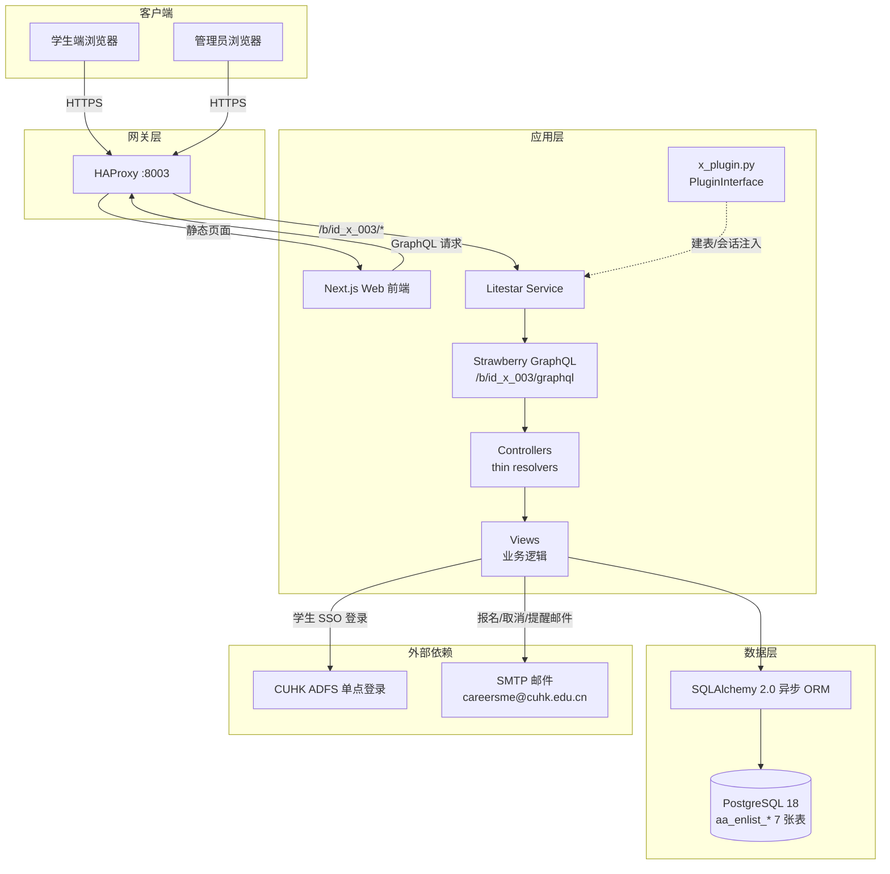
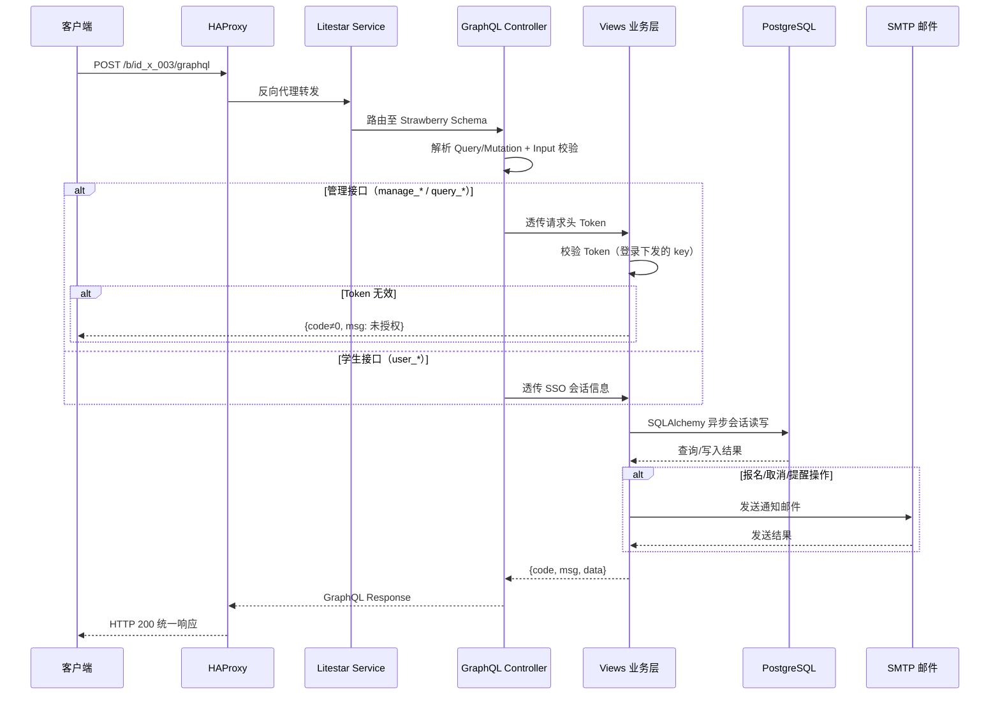

<div align="center">

# id_x_003: SME 校友咨询（Alumni Advising）预约系统

**咨询主题发布 → 时段排期 → 学生报名 → 邮件提醒 → 数据导出，全流程线上化的一对一咨询预约平台**


</div>

---

## ⚫ 1. 简介 (Introduction)

- **Slogan**: 为经管学院「校友咨询项目」提供线上化的一对一咨询预约能力，覆盖咨询主题发布、时段排期、学生报名、邮件提醒、取消反馈与数据汇总导出的全流程闭环。
- **Description**: 本系统由 `sme_cdc_enlist_aa`（Quart + 同步 SQLAlchemy + REST）重构而来，业务逻辑保持不变，重构为 Litestar + Strawberry GraphQL 单一入口架构。面向三类用户：学生（CUHK 统一身份认证登录，自助浏览/报名/取消）、管理员（CDC 运营人员，维护主题、排期、导入导出、跨活动查询）、校友顾问（被动参与，通过邮件自动触达预约动态）。学生侧将邮件/微信沟通升级为自助式在线预约；管理侧将人工登记表升级为结构化数据，支持批量排期与一键导出。

## ⚫ 2. 核心特性 (Features)

- 学生端活动浏览：分页列表、时间区间与活动名筛选、活动名前缀模糊搜索、活动详情查询
- 学生自助报名：同周唯一性校验，提交/取消均自动触发邮件通知（学生 + 校友顾问）
- 管理后台项目维护：咨询主题的增删改查，删除项目时级联清理活动与报名记录
- 排期管理：单条创建活动，或上传 `.xlsx` 批量排期；提供 14 天批量排期模板下载
- 数据查询与导出：按活动名 + 时间区间跨活动查询报名数据，支持 Excel（base64）导出

## ⚫ 3. 项目亮点 (Highlights)

1. **GraphQL 单一入口架构** —— 全部业务收敛于 `/b/id_x_003/graphql` 一个端点，Query/Mutation 职责清晰，替代原 REST 多路由模式
2. **Thin Resolver 分层设计** —— Controller 只做参数透传，业务逻辑集中于 Views 层，Schemas 层纯契约无逻辑，便于测试与维护
3. **插件化接入** —— 通过 `PluginInterface` 懒加载接入宿主框架，统一负责建表与会话注入，与 i-Torch 其他插件解耦
4. **响应契约向后兼容** —— 统一 `{code, msg, data}` 响应结构，与原 REST 系统完全一致，前端零迁移成本
5. **文件传输协议统一** —— 模板下载、数据导出以 `file_name + file_base64` 返回，批量排期上传同协议传入 `.xlsx`，无需额外文件服务
6. **容器化一键部署** —— podman-compose 编排 PostgreSQL / Service / Web / HAProxy 四组件，`ops/up.sh` 一条命令拉起完整环境

## ⚫ 4. 技术栈 (Tech Stack)

表1 技术栈一览

| 分类 | 名称 | 版本 | 用途 |
|------|------|------|------|
| 编程语言 | Python | 3.10 | 后端服务 |
| 编程语言 | TypeScript | 5.x | 前端开发 |
| Web 框架 | Litestar | 2.x | HTTP 服务与路由挂载 |
| API 层 | Strawberry GraphQL | latest | GraphQL Schema（Query/Mutation） |
| ORM | SQLAlchemy | 2.0（异步） | 数据访问层 |
| 数据库 | PostgreSQL | 18 | 关系数据存储（7 张 `aa_*` 表） |
| 前端框架 | Next.js + React | 16 / 19 | 学生端与管理端页面 |
| UI 组件 | HeroUI + FullCalendar | 3.x / 6.x | 界面组件与日历排期 |
| 网关 | HAProxy | 3.2 | 反向代理与流量分发（端口 8003） |
| 构建部署 | Podman Compose | — | 容器编排（`ops/`） |

## ⚫ 5. 整体架构图 (Overall Architecture Diagram)



## ⚫ 6. 请求流转图 (Request Flow Diagram)



## ⚫ 7. 目录结构 (Directory Structure)

```text
id_x_003/
├── x_plugin.py                 # 插件入口（PluginInterface：建表/会话注入，懒加载）
├── LICENSE                     # AGPL-3.0 许可证
├── .python-version             # Python 3.10
├── src/
│   ├── models/x_models.py      # ORM 模型（aa_enlist_* 7 张表）+ Base + 会话工厂
│   ├── schemas/x_schemas.py    # Strawberry Input/Type 契约（无业务逻辑）
│   ├── views/x_views.py        # 全部业务逻辑（view_* 命名，约 1800 行）
│   └── controllers/x_controllers.py  # GraphQL Query/Mutation，thin resolvers
├── docs/
│   └── project.md              # 产品功能文档（角色权限/业务流程/字段说明）
├── web/                        # 前端（Next.js 16 + React 19）
│   ├── src/api/                # GraphQL/axios 请求封装
│   ├── src/components/aa/      # 日历、活动表单、富文本等业务组件
│   └── src/app/f/aa/           # 学生端与管理端页面路由
└── ops/                        # 部署配置
    ├── podman-compose.yml      # 四组件编排（db/service/web/haproxy）
    ├── Dockerfile.service      # 后端镜像
    ├── haproxy.cfg             # 网关配置（对外 8003 端口）
    ├── init/01_init.sql        # 数据库初始化脚本
    └── up.sh / down.sh         # 一键启停脚本
```

## ⚫ 8. API 接口文档 (API Documentation)

系统对外仅暴露一个 GraphQL 端点：`POST /b/id_x_003/graphql`。

- 响应统一为 `{code, msg, data}`，`data` 为 JSON 载荷，与原 REST 响应结构一致
- 管理接口需在请求头携带 `Token`（登录后下发的 `key`）
- 文件类接口以 `file_name + file_base64` 传输入/输出 `.xlsx`

表2 GraphQL 操作汇总

| 类型 | 操作名 | 说明 | 鉴权 |
|------|--------|------|------|
| Query | `health` | 健康检查 | 无 |
| Query | `user_activity_list` / `user_activity_search` / `user_activity_fuzzy_name` | 学生端活动列表/详情/模糊搜索 | SSO |
| Query | `user_activity_detail` | 我的报名记录（分页） | SSO |
| Query | `manage_project_list` / `manage_project_search` / `manage_project_owner_search` / `manage_project_name_list` | 项目查询类 | Token |
| Query | `manage_activity_list` / `manage_activity_detail` / `manage_activity_name_list` / `manage_activity_search` | 活动查询类 | Token |
| Query | `manage_activity_export` / `manage_activity_download` | 报名数据导出 / 排期模板下载（FileResponse） | Token |
| Query | `query_title_search` / `query_data_search` / `query_data_download` | 跨活动数据查询与下载 | Token |
| Mutation | `login` / `logout` | 管理员账号密码登录/登出 | 无 |
| Mutation | `user_activity_oauth` | 学生 SSO 登录（首次自动建档） | 无 |
| Mutation | `user_activity_apply` / `user_activity_delete` | 学生报名（同周唯一校验）/ 取消，均触发邮件 | SSO |
| Mutation | `manage_project_create` / `manage_project_update` / `manage_project_delete` | 项目维护（删除级联清理） | Token |
| Mutation | `manage_activity_create` / `manage_activity_update` / `manage_activity_delete` | 活动维护（删除级联报名） | Token |
| Mutation | `manage_activity_upload` | 批量上传排期（.xlsx, base64） | Token |

请求示例（管理员登录）：

```bash
curl -X POST "<BASE_URL>/b/id_x_003/graphql" \
  -H "Content-Type: application/json" \
  -d '{"query":"mutation { login(data: {username: \"<USERNAME>\", password: \"<PASSWORD>\"}) { code msg data } }"}'
```

请求示例（管理接口，携带 Token）：

```bash
curl -X POST "<BASE_URL>/b/id_x_003/graphql" \
  -H "Content-Type: application/json" \
  -H "Token: <TOKEN>" \
  -d '{"query":"query { manage_project_list(data: {page: 1, page_size: 10}) { code msg data } }"}'
```

## ⚫ 9. 快速部署 (Quick Deploy)

### 环境准备 (Prerequisites)

- Podman + podman-compose（推荐），或 Docker + docker-compose
- Python 3.10（本地开发后端）；Node.js 20+（本地开发前端）

### 安装 (Installation)

```bash
git clone <仓库地址>
cd i-Torch/x_models/id_x_003/ops
cp .env.example .env   # 填入 POSTGRES_DB / POSTGRES_USER / POSTGRES_PASSWORD / AA_MAIL_PASSWORD
```

### 运行 (Run)

```bash
cd ops
./up.sh                # 构建并启动 db / service / web / haproxy
./down.sh              # 停止并清理
```

启动后通过 HAProxy 访问：`http://localhost:8003/f/aa`。

### 容器部署 (Container Deploy)

使用 podman-compose 手动操作：

```bash
cd ops
podman-compose --env-file .env up -d --build   # 构建并后台启动全部服务
podman-compose ps                              # 查看容器状态
podman-compose logs -f service                 # 跟踪后端日志
```

本地开发模式：

```bash
# 后端（在 i-Torch 宿主工程中运行，插件自动挂载至 /b/id_x_003/graphql）
# 前端
cd web && npm install && npm run dev           # 默认端口 2000
```
