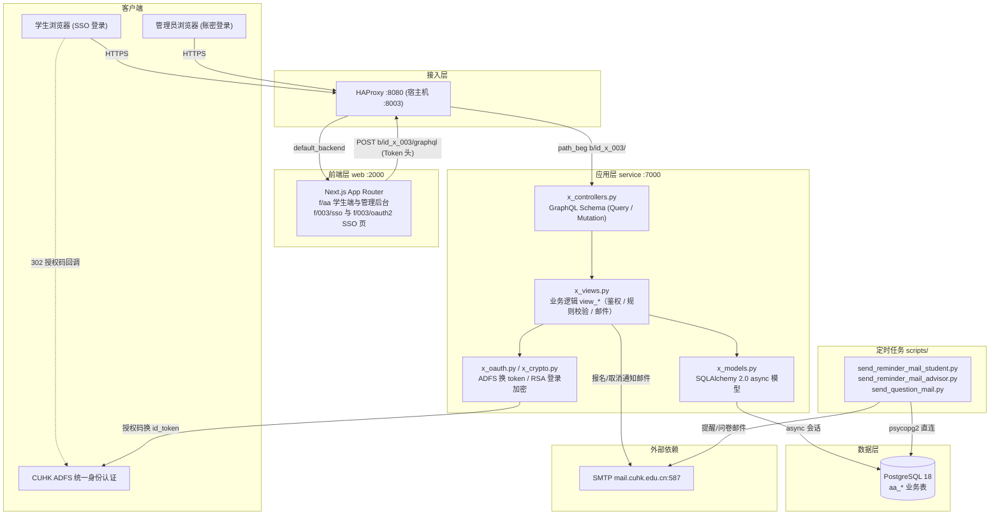
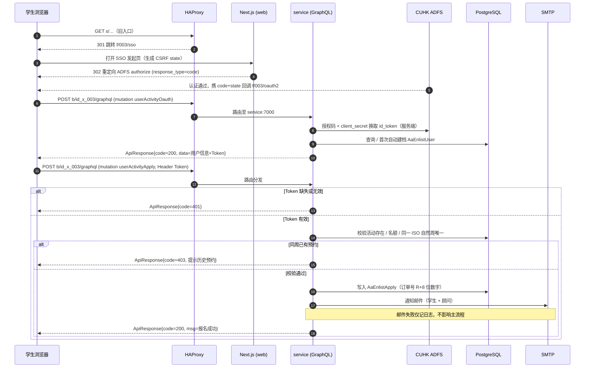

<div align="center">

# id_x_003: SME 校友咨询（Alumni Advising）预约系统

**把「找校友咨询」从邮件与微信沟通，升级为全流程自助式在线预约**


</div>

---

## 1 简介 (Introduction)

**Slogan**：为香港中文大学（深圳）经济管理学院「校友咨询项目（SME Alumni Advising Program）」提供一对一咨询的线上化预约平台。

**Description**：本项目覆盖**咨询主题发布 → 时段排期 → 学生报名 → 邮件提醒 → 取消与反馈 → 数据汇总导出**的完整业务闭环。学生通过大学统一身份认证（Active Directory Federation Services, ADFS）单点登录（Single Sign-On, SSO）自助报名与取消；管理员（经管学院职业发展中心 CDC 运营人员）维护咨询主题与排期、批量导入时段、导出报名明细；校友顾问无需登录，由系统邮件自动触达。

与传统人工登记表或通用报名工具相比，本系统的优势在于：

- 业务规则内建：同一 ISO 自然周仅可预约一次、活动结束前 4 小时禁止取消、距开始不足 1 天自动关闭报名等规则由服务端强制校验；
- 以插件形式接入 i-Core 宿主框架（实现 `PluginInterface`，懒加载内部模块），与其他业务模块共享数据库会话与日志基础设施；
- 全链路工程化：单一 GraphQL 端点、HAProxy 统一入口、Podman 容器化一键启停、cron 定时邮件自动化。

## 2 核心特性 (Features)

- **学生端自助预约**：列表 / FullCalendar 日历双视图浏览未来活动，状态标签（Open / Full / Closed）实时判定，选话题提交报名并生成订单号（`R` + 8 位数字）。
- **管理后台全流程运营**：咨询主题（项目）与活动排期的增删改查、14 天批量排期模板下载与 `.xlsx` 上传（命中更新、未命中新增）、单活动报名明细查看。
- **双通道认证**：管理员走用户名密码登录（RSA-OAEP-SHA256 公钥加密传输 + 验证码），学生走 ADFS OAuth2 授权码授予流（`client_secret` 仅存服务端）。
- **邮件自动化触达**：报名 / 取消即时通知学生与顾问；cron 定时任务在活动前一日 21:00 发送双端提醒、活动结束满 2 小时发送反馈问卷（同一报名去重只发一次）。
- **数据查询与导出**：按活动名 + 时间区间跨活动查询报名数据，一键导出 Excel（openpyxl 生成，base64 传输下载）。

## 3 项目亮点 (Highlights)

1. **插件化架构** —— 通过 `x_plugin.py` 实现宿主框架的 `PluginInterface` 契约，`Base` 模型与会话工厂均为懒加载注入，插件可独立建表（`build_tables`）、独立部署，与宿主解耦。
2. **GraphQL 安全闭环** —— Schema 层启用 `DisableIntrospection`（关闭内省）与 `QueryDepthLimiter(max_depth=8)`（防深层嵌套 DoS）；路由层禁用 GraphiQL IDE、仅接受 POST 查询，杜绝 GET 直达与缓存投毒。
3. **凭证零前端暴露** —— 登录口令经服务端下发的 RSA-2048 公钥（OAEP-SHA256）加密后提交；ADFS 授权码换 `id_token` 在服务端完成，`client_secret` 严禁进入 web 容器与 `NEXT_PUBLIC_*` 构建期变量。
4. **纵深防御的接入层** —— HAProxy 统一收敛安全响应头（`X-Content-Type-Options` / `X-Frame-Options` / `Referrer-Policy`），TLS 默认收紧至 TLSv1.2+ 并禁弱套件，预留 HTTPS 8443 与 HSTS 一键启用开关。
5. **时区确定性** —— 进程级锚定 `Asia/Shanghai`（`TZ` + `time.tzset()`），容器、裸跑、cron 三种运行形态下 `datetime.now()` 行为一致，杜绝 UTC 回退导致的排期错乱。
6. **资源上限防护** —— 上传文件解码后字节数上限默认 10 MiB（`AA_MAX_UPLOAD_BYTES`），防止超大 base64 载荷造成内存耗尽；环境变量解析失败安全回退默认值，避免导入期崩溃。
7. **幂等化运维脚本** —— `ops/up.sh` 对镜像、Pod、数据卷、容器逐项「存在即跳过」，可反复执行；数据库健康检查就绪后再拉起服务，消除启动竞态。

## 4 技术栈 (Tech Stack)

<p align="center"><b>表1 技术栈一览</b></p>

| 分类 | 名称 | 版本 | 用途 |
| --- | --- | --- | --- |
| 编程语言 | Python | 3.10 | 后端服务与定时脚本 |
| 编程语言 | TypeScript | 5.x | 前端应用 |
| 核心框架 | Litestar + Strawberry GraphQL | — | GraphQL API 服务（异步） |
| 核心框架 | Next.js / React | 16.x / 19.x | 前端 App Router 应用 |
| UI 组件 | HeroUI + Tailwind CSS + FullCalendar | 3.x / 4.x / 6.x | 组件库、样式与日历视图 |
| 数据库 | PostgreSQL | 18 | 业务数据存储 |
| ORM | SQLAlchemy（async） | 2.0 | 异步数据访问 |
| 数据处理 | pandas + openpyxl | — | Excel 批量导入与报表导出 |
| 接入层 | HAProxy | 3.2 | 反向代理、路由分发、安全头 |
| 构建/运维 | Podman + podman-compose + uv | — | 容器构建、编排与依赖安装 |
| 定时任务 | cron + psycopg2 | — | 提醒 / 问卷邮件自动化 |

## 5 整体架构图 (Overall Architecture Diagram)



## 6 请求流转图 (Request Flow Diagram)

以学生「SSO 登录后提交报名」为例的完整生命周期：



## 7 目录结构 (Directory Structure)

```text
id_x_003/
├── x_plugin.py                  # 插件入口：实现 PluginInterface，懒加载模型并注入会话工厂
├── src/                         # 后端源码（由宿主框架按插件加载）
│   ├── controllers/
│   │   └── x_controllers.py     # GraphQL Schema（Query/Mutation）与路由注册，含安全加固
│   ├── views/
│   │   └── x_views.py           # 全部业务逻辑（鉴权、业务规则、Excel、邮件）
│   ├── models/
│   │   └── x_models.py          # SQLAlchemy 2.0 async 模型（用户/项目/活动/报名/模板/顾问）
│   ├── schemas/
│   │   └── x_schemas.py         # Strawberry Input/Type 契约定义（纯类型，无逻辑）
│   └── utils/
│       ├── x_oauth.py           # ADFS OAuth2 授权码流：换 token、JWT 校验
│       └── x_crypto.py          # 登录传输加密：RSA-2048 OAEP-SHA256
├── web/                         # 前端 Next.js 应用（独立构建，端口 2000）
│   ├── src/app/f/aa/            # 页面路由：login / user（学生端）/ admin（管理后台）
│   ├── src/app/f/003/           # SSO 发起页与 OAuth2 回调页
│   ├── src/views/               # 页面级视图组件（活动/项目/查询/导出等）
│   ├── src/components/          # 业务与通用组件（表单、日历、富文本、布局）
│   ├── src/api/                 # GraphQL/HTTP 客户端封装（axios）
│   └── src/utils/               # SSO、加密、分页、下载等工具
├── scripts/                     # cron 定时邮件脚本（psycopg2 直连数据库）
│   ├── send_reminder_mail_student.py   # 每日 21:00 学生提醒（活动日=明日）
│   ├── send_reminder_mail_advisor.py   # 每日 21:00 顾问提醒（活动日=明日）
│   └── send_question_mail.py           # 每 2 小时问卷邮件（结束满 2h 且未发过）
├── ops/                         # 容器化运维
│   ├── podman-compose.yml       # db / service / web / haproxy 四容器编排
│   ├── Dockerfile.service       # 后端镜像（uv 安装依赖，非 root 运行）
│   ├── haproxy.cfg              # 路由分发、安全头、TLS 预留配置
│   ├── init/                    # PostgreSQL 初始化 SQL（建库建表、初始账号）
│   ├── up.sh / down.sh          # Pod 模式一键启停（幂等）
│   └── .env.example             # 环境变量模板（OAuth/邮件/数据库）
├── docs/                        # 产品功能文档、需求规格说明书、邮件模板
└── LICENSE                      # GNU AGPL-3.0
```

## 8 API 接口文档 (API Documentation)

对外仅暴露**单一 GraphQL 端点**（已禁用 introspection 与 GraphiQL，仅接受 POST）：

- 端点：`POST <BASE_URL>/b/id_x_003/graphql`
- 鉴权：除公开操作外，均需在请求头携带 `Token: <TOKEN>`（登录 / SSO 成功后由服务端下发）
- 统一响应：`ApiResponse { code, msg, data }`；文件类操作返回 `FileResponse { code, msg, fileName, fileBase64 }`
- 业务状态码：`200` 成功、`400` 参数/文件格式错误、`401` 未登录、`403` 违反业务规则（如同周重复报名）、`404` 资源不存在、`500` 服务器错误

### 8.1 Query（查询）

<p align="center"><b>表2 Query 操作汇总</b></p>

| 操作名 | 鉴权 | 说明 |
| --- | --- | --- |
| `health` | 否 | 健康检查，返回服务状态 |
| `loginKey` | 否 | 下发 RSA-2048 公钥（PEM），前端加密账密用 |
| `userActivityList(data)` | Token | 学生端活动列表（分页，时间区间 + 活动名筛选） |
| `userActivitySearch(activityId)` | Token | 学生端活动详情 |
| `userActivityFuzzyName(data)` | Token | 活动名前缀模糊搜索 |
| `userActivityDetail(data)` | Token | 我的报名记录（分页） |
| `manageProjectList(data)` | Token | 项目列表（分页） |
| `manageProjectSearch(data)` | Token | 项目详情 |
| `manageProjectOwnerSearch` | Token | 顾问列表 |
| `manageProjectNameList` | Token | 项目名称列表 |
| `manageActivityList(data)` | Token | 活动列表（分页） |
| `manageActivityDetail(activityId)` | Token | 单活动报名明细 |
| `manageActivityNameList(data)` | Token | 活动名称列表（去重，分页） |
| `manageActivitySearch(data)` | Token | 活动详情 |
| `manageActivityExport(data)` | Token | 导出报名数据（Excel，base64） |
| `manageActivityExportFuzzyName(data)` | Token | 导出页活动名模糊搜索 |
| `manageActivityDownload` | Token | 下载 14 天批量排期模板（Excel，base64） |
| `queryTitleSearch` | Token | 全部活动标题列表 |
| `queryDataSearch(data)` | Token | 按活动名 + 时间区间查询报名数据（分页） |
| `queryDataDownload(data)` | Token | 按活动名下载报名数据（Excel，base64） |

### 8.2 Mutation（变更）

<p align="center"><b>表3 Mutation 操作汇总</b></p>

| 操作名 | 鉴权 | 说明 |
| --- | --- | --- |
| `login(data)` | 否 | 管理员账密登录（RSA 加密传输，触发验证码后需附验证码） |
| `logout(data)` | Token | 登出 |
| `userActivityOauth(data)` | 否 | 学生 SSO 登录（ADFS 授权码 + state，首次自动建档） |
| `userActivityApply(data)` | Token | 学生提交报名（同周唯一校验 + 双端邮件通知） |
| `userActivityDelete(data)` | Token | 学生取消报名（结束前 4 小时内禁取消，删除记录 + 邮件通知） |
| `manageProjectCreate(data)` | Token | 创建项目（名称/富文本内容/名额/顾问） |
| `manageProjectUpdate(data)` | Token | 更新项目 |
| `manageProjectDelete(data)` | Token | 删除项目（级联删除其下活动与报名） |
| `manageActivityCreate(data)` | Token | 创建活动（校验开始 ≤ 结束） |
| `manageActivityUpdate(data)` | Token | 更新活动 |
| `manageActivityDelete(data)` | Token | 删除活动（级联删除报名） |
| `manageActivityUpload(fileName, fileBase64)` | Token | 批量上传排期（`.xlsx` base64，命中更新、未命中新增） |

### 8.3 调用示例

健康检查（无需鉴权）：

```bash
curl -sS -X POST "<BASE_URL>/b/id_x_003/graphql" \
  -H "Content-Type: application/json" \
  -d '{"query": "query { health { status service } }"}'
```

学生查询活动列表（需替换 `<BASE_URL>` 与 `<TOKEN>`）：

```bash
curl -sS -X POST "<BASE_URL>/b/id_x_003/graphql" \
  -H "Content-Type: application/json" \
  -H "Token: <TOKEN>" \
  -d '{
    "query": "query($data: UserActivityListInput!) { userActivityList(data: $data) { code msg data } }",
    "variables": { "data": { "offset": 1, "limit": 10, "fuzzyName": "" } }
  }'
```

学生提交报名：

```bash
curl -sS -X POST "<BASE_URL>/b/id_x_003/graphql" \
  -H "Content-Type: application/json" \
  -H "Token: <TOKEN>" \
  -d '{
    "query": "mutation($data: UserActivityApplyInput!) { userActivityApply(data: $data) { code msg data } }",
    "variables": { "data": { "userId": <USER_ID>, "activityId": <ACTIVITY_ID>, "info": "<咨询话题>" } }
  }'
```

## 9 快速部署 (Quick Deploy)

### 9.1 环境准备 (Prerequisites)

- Podman ≥ 4.x（Pod 模式）或 podman-compose（Compose 模式）
- 可访问容器镜像仓库（PostgreSQL 18、HAProxy 3.2、Node 24、Python 3.10 基础镜像）
- 本地开发另需：Python 3.10 + uv、Node.js ≥ 24

### 9.2 安装 (Installation)

```bash
cd x_models/id_x_003/ops
cp .env.example .env
# 编辑 .env：填入 AA_OAUTH_CLIENT_ID / AA_OAUTH_CLIENT_SECRET /
# AA_OAUTH_REDIRECT_URI / AA_MAIL_PASSWORD / POSTGRES_* 等配置
```

前端构建期变量（如需变更域名 / 回调地址）：

```bash
cd ../web
cp .env.local.example .env.local
# 编辑 NEXT_PUBLIC_SITE_URL / NEXT_PUBLIC_ADFS_CLIENT_ID / NEXT_PUBLIC_ADFS_REDIRECT_URI
```

### 9.3 运行 (Run)

Pod 模式一键启动（推荐，幂等可重复执行）：

```bash
cd x_models/id_x_003/ops
./up.sh            # 首次执行自动构建镜像并顺序拉起 db → service → web → haproxy
./up.sh --build    # 强制重新构建镜像
./down.sh          # 停止并清理
```

启动完成后访问：

- 统一入口：`http://localhost:8003`（HAProxy，`b/id_x_003/` 前缀转发后端，其余转发前端）
- 管理后台 / 学生端：`http://localhost:8003/f/aa`
- PostgreSQL：宿主机 `localhost:35432`

### 9.4 容器部署 (可选)

Compose 模式（podman-compose）：

```bash
cd x_models/id_x_003/ops
podman-compose up -d --build
podman-compose down
```

定时邮件任务（宿主机 crontab，脚本直连数据库并读取 `ops/.env`，`<REPO_ROOT>` 替换为仓库根目录绝对路径）：

```bash
# 活动前一日提醒（学生 + 顾问），每天 21:00
0 21 * * * python3 <REPO_ROOT>/x_models/id_x_003/scripts/send_reminder_mail_student.py
0 21 * * * python3 <REPO_ROOT>/x_models/id_x_003/scripts/send_reminder_mail_advisor.py
# 反馈问卷（活动结束满 2 小时，去重），每 2 小时
0 */2 * * * python3 <REPO_ROOT>/x_models/id_x_003/scripts/send_question_mail.py
```

生产环境启用 HTTPS：将 `fullchain.pem` 与私钥合并为 `site.pem` 挂载至 HAProxy 容器证书目录（`usr/local/etc/haproxy/certs/site.pem`），并按 `ops/haproxy.cfg` 内注释取消 8443 bind、301 跳转与 HSTS 响应头的注释。
