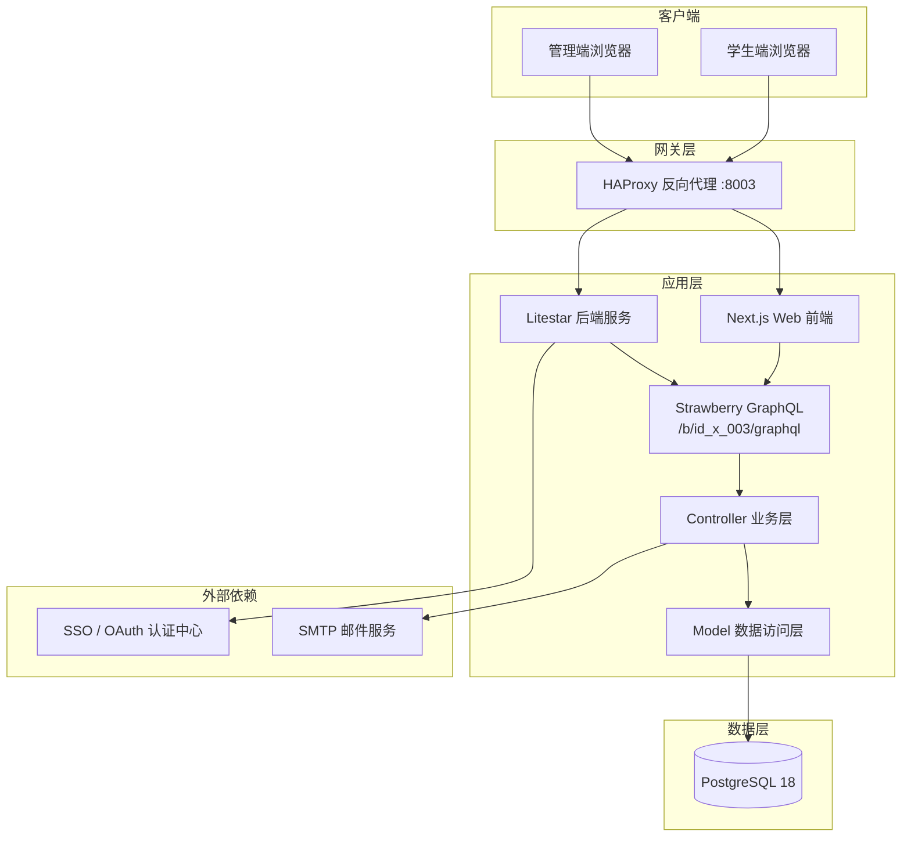
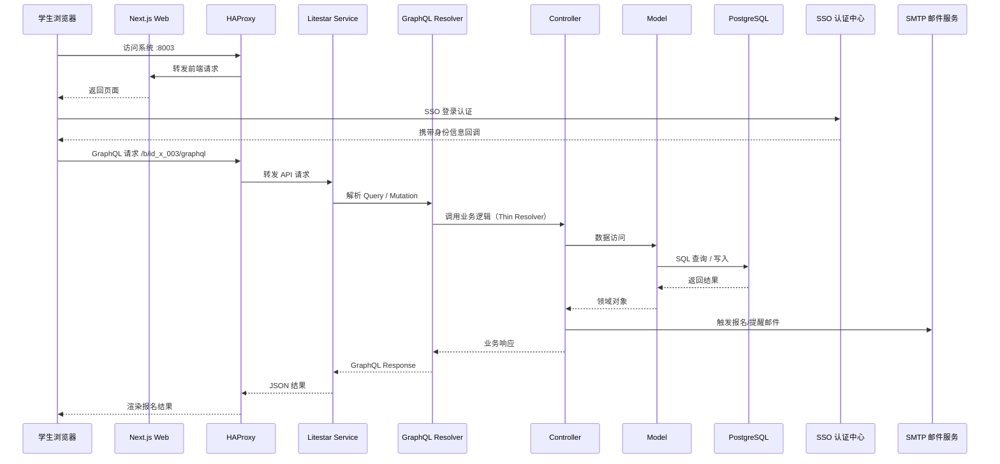

<div align="center">

# id_x_003: SME 校友咨询（Alumni Advising）预约系统

**咨询主题发布 → 时段排期 → 学生报名 → 邮件提醒 → 数据导出，全流程线上化的一对一咨询预约平台**


</div>

---

## 1. 简介 (Introduction)

**咨询主题发布 → 时段排期 → 学生报名 → 邮件提醒 → 数据导出，全流程线上化的一对一咨询预约平台**

SME 校友咨询（Alumni Advising）预约系统是面向经管学院（SME）职业发展中心（CDC）的一对一校友咨询预约平台。系统将传统线下协调的咨询流程全面线上化：校友/顾问发布咨询主题，管理员批量排期可预约时段，学生浏览活动并自助报名，系统自动完成同周唯一性校验、SSO 身份认证与会前邮件提醒，管理人员可实时查询报名数据并一键导出 Excel 报表，实现咨询活动全生命周期的数字化管理。

## 2. 核心特性 (Features)

- **学生端活动浏览**：支持分页、筛选与关键字搜索的活动列表，结合 FullCalendar 日历视图直观呈现可预约时段
- **自助报名与校验**：学生在线完成咨询报名，系统自动执行同周唯一性校验，避免重复预约冲突
- **管理后台维护**：咨询项目（Project）与活动（Activity）全周期维护，支持通过 `.xlsx` 模板批量上传排期
- **数据查询与导出**：报名数据多维度查询，导出结果为 Base64 编码的 Excel 文件，前端直接下载
- **SSO 登录与邮件通知**：对接统一身份认证（OAuth/SSO），报名确认、会前提醒等关键节点自动触发邮件通知

## 3. 项目亮点 (Highlights)

1. **全流程线上化闭环**：覆盖「主题发布 → 时段排期 → 学生报名 → 邮件提醒 → 数据导出」完整业务链路，消除线下协调成本
2. **GraphQL 单一入口**：所有数据交互经由统一入口 `/b/id_x_003/graphql`，Schema 即文档，前后端契约清晰
3. **Thin Resolver 分层架构**：Resolver 仅负责参数解析与响应组装，业务逻辑下沉至 Controller 层，数据访问收敛于 Model 层，职责边界清晰、易于测试
4. **插件化接入机制**：通过 `x_plugin.py` 实现 `PluginInterface` 标准插件协议，模块可热插拔式挂载至主工程 i-Core，与其他 `id_x_*` 模块互不干扰
5. **业务规则引擎化校验**：同周唯一性、时段冲突等报名约束在服务端统一校验，前端只做提示，保证数据一致性
6. **运维开箱即用**：`podman-compose` 一键编排 db / service / web / haproxy 四组件，HAProxy 统一反向代理，端口 8003 对外服务

## 4. 技术栈 (Tech Stack)

| 分类 | 名称 | 版本 | 用途 |
| --- | --- | --- | --- |
| 后端框架 | Litestar | 2.x | ASGI Web 框架，承载 HTTP 请求与路由 |
| GraphQL | Strawberry GraphQL | latest | Schema 定义与 GraphQL 执行引擎 |
| 后端语言 | Python | 3.10 | 服务端开发语言 |
| 前端框架 | Next.js | 16.x | React 全栈框架（App Router） |
| UI 库 | React | 19.x | 前端视图层 |
| 组件库 | HeroUI | 3.x | 现代化 UI 组件库 |
| 日历组件 | FullCalendar | 6.x | 活动时段日历展示 |
| 前端语言 | TypeScript | 5.x | 前端开发语言 |
| 数据库 | PostgreSQL | 18 | 关系型数据存储 |
| 反向代理 | HAProxy | latest | 四组件统一入口与负载均衡 |
| 容器编排 | podman-compose | latest | 本地/服务器容器化部署 |

## 5. 整体架构图 (Overall Architecture Diagram)



## 6. 请求流转图 (Request Flow Diagram)



## 7. 目录结构 (Directory Structure)

```text
id_x_003/
├── __init__.py                 # 模块包入口
├── x_plugin.py                 # 插件定义（实现 PluginInterface）
├── LICENSE                     # AGPL-3.0 许可证
├── README.md                   # 项目说明文档
├── docs/                       # 业务文档（邮件模板、项目说明）
├── src/
│   ├── models/
│   │   └── x_models.py         # 数据模型与数据访问层
│   ├── schemas/
│   │   └── x_schemas.py        # Strawberry GraphQL Schema 定义
│   ├── views/
│   │   └── x_views.py          # GraphQL Resolver（Thin Resolver 层）
│   ├── controllers/
│   │   └── x_controllers.py    # 业务逻辑层
│   └── utils/
│       ├── x_crypto.py         # 加解密工具
│       └── x_oauth.py          # SSO / OAuth 接入
├── web/                        # Next.js 16 前端工程
│   ├── Dockerfile
│   ├── package.json
│   ├── next.config.ts
│   ├── public/                 # 静态资源
│   └── src/
│       ├── api/                # GraphQL / HTTP 请求封装
│       ├── app/                # App Router 页面
│       ├── components/         # 通用组件
│       ├── views/              # 业务视图（学生端 / 管理端）
│       ├── context/            # React Context
│       ├── layout/             # 布局组件
│       └── utils/              # 前端工具函数
├── scripts/                    # 邮件脚本（提醒、问卷推送）
└── ops/                        # 运维部署
    ├── podman-compose.yml      # 四组件编排（db/service/web/haproxy）
    ├── Dockerfile.service      # 后端镜像
    ├── haproxy.cfg             # 反向代理配置（:8003）
    ├── init/                   # 数据库初始化 SQL
    ├── up.sh                   # 一键启动
    └── down.sh                 # 一键停止
```

## 8. API 接口文档 (API Documentation)

系统所有数据交互均通过 GraphQL 单一入口进行，前后端共享同一份 Schema 契约。

**Endpoint**

```text
POST /b/id_x_003/graphql
```

**请求头**

| 字段 | 值 | 说明 |
| --- | --- | --- |
| Content-Type | application/json | 固定 |
| Authorization | Bearer &lt;token&gt; | SSO 登录后颁发的访问令牌 |

**核心操作**

| 类型 | 操作名 | 说明 | 鉴权 |
| --- | --- | --- | --- |
| Query | activityPage | 活动分页查询（支持筛选 / 搜索） | 学生 |
| Query | activityDetail | 活动详情查询 | 学生 |
| Query | myApplyRecords | 我的报名记录 | 学生 |
| Query | adminProjectList | 管理端项目列表 | 管理员 |
| Query | adminApplyQuery | 报名数据多维度查询 | 管理员 |
| Mutation | applyActivity | 学生自助报名（同周唯一校验） | 学生 |
| Mutation | cancelApply | 取消报名 | 学生 |
| Mutation | saveProject | 新建 / 更新咨询项目 | 管理员 |
| Mutation | uploadSchedule | 批量排期上传（.xlsx） | 管理员 |
| Mutation | exportReport | 数据导出（Base64 Excel） | 管理员 |

**Query 示例 — 活动分页查询**

```bash
curl -X POST 'http://localhost:8003/b/id_x_003/graphql' \
  -H 'Content-Type: application/json' \
  -H 'Authorization: Bearer <token>' \
  -d '{
    "query": "query { activityPage(page: 1, size: 10, keyword: \"职业\") { total items { id title startTime location advisorName } } }"
  }'
```

**Mutation 示例 — 学生报名**

```bash
curl -X POST 'http://localhost:8003/b/id_x_003/graphql' \
  -H 'Content-Type: application/json' \
  -H 'Authorization: Bearer <token>' \
  -d '{
    "query": "mutation { applyActivity(activityId: 42) { success message } }"
  }'
```

**Mutation 示例 — 数据导出（返回 Base64 Excel）**

```bash
curl -X POST 'http://localhost:8003/b/id_x_003/graphql' \
  -H 'Content-Type: application/json' \
  -H 'Authorization: Bearer <admin-token>' \
  -d '{
    "query": "mutation { exportReport(projectId: 1) { filename base64Content } }"
  }'
```

## 9. 快速部署 (Quick Deploy)

**Prerequisites**

- Podman 与 podman-compose（或 Docker + docker-compose）
- Python 3.10+（本地开发后端）
- Node.js 20+（本地开发前端）
- PostgreSQL 18（容器部署时由编排自动拉起，可跳过本地安装）

**Installation**

```bash
# 1. 克隆主工程（id_x_003 作为插件模块位于 x_models/ 下）
git clone <repo-url> i-Core
cd i-Core/x_models/id_x_003

# 2. 安装后端依赖（本地开发）
pip install -r requirements.txt

# 3. 安装前端依赖（本地开发）
cd web && npm install
```

**Run（本地开发）**

```bash
# 启动后端（Litestar，GraphQL 挂载于 /b/id_x_003/graphql）
litestar --app src.views.x_views:app run --port 8003

# 启动前端（Next.js 开发服务器）
cd web && npm run dev
```

**Container Deploy（推荐）**

```bash
cd ops

# 一键启动四组件（db / service / web / haproxy）
./up.sh

# 访问入口：http://localhost:8003
# GraphQL：http://localhost:8003/b/id_x_003/graphql

# 停止并清理
./down.sh
```

容器编排说明：`haproxy` 作为唯一对外入口（端口 8003），按路径将请求分发至 `web`（Next.js 前端）与 `service`（Litestar 后端），`service` 依赖 `db`（PostgreSQL 18）并通过 `init/` 下的 SQL 完成首次初始化。邮件发送相关脚本位于 `scripts/`，可按需在容器内或计划任务中执行。
